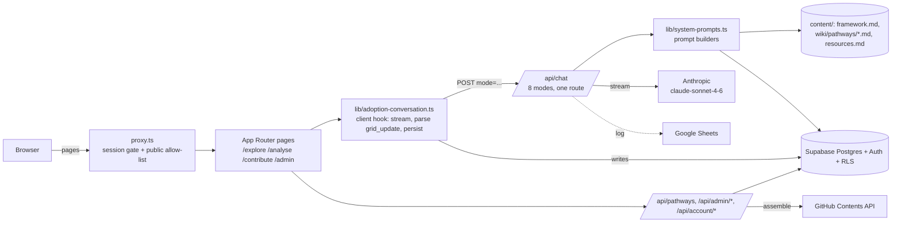

“On branch cube-2, the Cube 2.0 section at the bottom takes precedence over anything above it.# 100 Pathways — Diffusion Cube (Adoption Companion)

## What this is

A Next.js web app, the conversational companion to **100pathways.com**. It helps people adopt AI well by grounding every answer in a corpus of real, documented AI deployments ("pathways"), tracked internally on a **4-dimension × 4-stage grid** (the "Cube"). Four surfaces share one app shell and one chat API:

| Surface | Who | What it does |
|---|---|---|
| **`/explore`** — Diffusion Library | Anyone, no login | Browse published pathway cards; chat with one pathway at a time, or with an overview of all of them |
| **`/analyse`** — Explorer | `adopter` role | Describe your own project (or upload documents); the Cube compares it against the whole corpus, fills the grid, and generates an **Analysis Document** / **Executive Summary** |
| **`/contribute`** — Contributor | `pathway_contributor` + approved registration | Turn your own deployment write-up into a new corpus pathway: auto-drafted, revised conversationally, then submitted |
| **`/admin`** | `admin` | Grant/revoke roles, approve/reject contributor registrations, publish/delete pathways |

Supporting pages: `/login` (email+password, 6-digit OTP signup/reset), `/account` (contact sharing, self-serve account deletion), `/terms`, `/privacy`, `(app)/wiki` (on-demand corpus browsing), `(app)/adoptions`. `/navigate` is a legacy redirect to `/analyse`; `/` redirects to `/explore`.

## Current functionality (verified against code on `cube-dev`)

### The framework / grid
- Dimensions: `persona`, `solution`, `institution`, `ecosystem` (each with weighted sub-categories). Stages: `Explore → Define → Pilot → Scale`. Shape lives in `lib/dimensions.ts`; behavior (what the model asks about) lives in **`content/framework.md`** — edit that file, not code, to change framework behavior.
- Grid state = 16 cells keyed `"<dimension>:<stage>"`, each `{ density: 0–3, note }`, stored in `designs.grid_state`. Rendered as a real table by `components/HeatmapGrid.tsx`, opened from a "Grid" button in the workspace (not shown persistently).

### Explorer (`/analyse`)
- One unified flow, `ANALYSE_FLOW` in `lib/explorer-intents.ts` (5 steps: gather silently → compare against corpus → name what matters next → keep going → offer the write-up). Old intent values (`discover`/`strengthen`/`troubleshoot`/`navigate`/`open`) still resolve to it for reopened conversations.
- Document upload with both sector and problem inferable short-circuits straight to `explorerAction: "analysis"` (two-line reply, document generated separately).
- Documents are versioned in `design_documents` (`doc_type` ∈ `analysis | plan | draft`), with a content-hash dedup so regenerating an unchanged conversation is a DB read, not a model call. PDF/Markdown export via `lib/adoption-plan-pdf.ts` / `lib/adoption-plan-markdown.ts`.

### Contributor (`/contribute`)
- Contributor registration → admin approval (approval also grants `pathway_contributor`).
- Create or join a pathway (`/api/pathways`, `/api/pathways/[id]/join`); duplicate detection via `/api/pathways/check-similar` (forced tool-use).
- Document-first conversation infers stage, then `pathway-draft` mode generates the full pathway document (Sections 0–6 + Source Trace appendix, per `content/pathway-generation-prompt.md`), stored as `design_documents` `doc_type='draft'`. Revisions merge into an existing published document rather than replacing it.

### Library (`/explore`)
- Cards come from the **`published_pathways`** table (fetched server-side with the service-role client so anonymous visitors work). The static Library corpus (`content/library-wiki/pathways/`, `lib/library-pathways.ts`) is **now empty** — its files were deleted; the loader still checks it first and falls back to the DB.
- `library` mode chat: one pathway document as grounding, or an overview of all pathways' frontmatter. No `<grid_update>`, no auth.

### Publishing (two independently gated steps)
1. **Contributor "assemble"** (`/api/pathways/assemble`) — commits the draft verbatim to GitHub (`content/wiki/pathways/<slug>.md`, via `lib/github.ts`) and to `pathways.content_cache`. This does **not** make it live.
2. **Admin "publish"** (`/api/admin/pathways/publish`) — copies into `published_pathways`, which is what `/explore` and grounding actually read. No redeploy needed.

### Auth & accounts
- Supabase Auth; OTP emails delivered through a custom Supabase Auth email hook (`/api/auth/send-email`, verified by `SEND_EMAIL_HOOK_SECRET`) over SMTP (`lib/email.ts`).
- New signups auto-get `adopter` (`/api/auth/grant-default-role`). Zero roles = "pending".
- Self-serve account deletion (`/api/account/delete`, migration `0033`): per-user rows cascade; published content survives with its publisher FK set null.

## High-level design



### Key design decisions
1. **One chat route, many modes.** `app/api/chat/route.ts` dispatches on `mode`: `companion`, `library`, `extract-insights`, `analysis-doc`, `executive-summary`, `plan-document`, `pathway-draft`, `pathway-exec-summary`. All stream from `claude-sonnet-4-6`. Auth/role checks live here (real enforcement); `library` is the only anonymous mode; `companion` re-checks `adopter` vs `pathway_contributor` against `meta.flow`.
2. **The model never writes to the DB.** Each `companion` reply ends with a `<grid_update>` JSON block (`cells`, `meta`, `pathwaysReferenced`, `flowStep`, plus `explorerAction` *or* `pathwayAction`). The client hook (`lib/adoption-conversation.ts`, parsed by `lib/grid-update.ts`) strips it, merges the grid, persists, and fires any follow-up document-generation call. `designs.meta` is re-injected every turn because the block is stripped before storage.
3. **Whole-corpus prompt injection.** Every companion turn gets the framework + all grounding pathways (`lib/wiki-loader.ts`: static `content/wiki/pathways/` merged with `published_pathways`). No retrieval layer — fine at current corpus size, the planned evolution is RAG.
4. **Three-deep access control.** `proxy.ts` only checks "is there a session" (with a public allow-list incl. `/explore`, `/analyse`, `/contribute`, `/api/chat`); pages render tiered access-gate messages; API routes re-check roles via `lib/roles.ts` (`general_user | adopter | pathway_contributor | admin`).
5. **No ORM, no repository layer.** Direct `@supabase/supabase-js` calls; clients in `lib/supabase/{client,server,admin}.ts`. Schema = sequential SQL in `supabase/migrations/` (currently `0001`–`0033`).
6. **Client-side document extraction** (`lib/extract-text.ts`: pdfjs, mammoth, SheetJS, jszip for PPTX) — uploads become text before they reach the API.

### Product rules the prompts enforce
- "Relevant" = same sector **and** same use-case category.
- Micro-innovations are suggestions, never recommendations.
- Absence is stated plainly — never backfilled with general AI/ML knowledge.
- Source Trace / provenance is contributor-only; never shown to adopters.
- The framework is never narrated as a process (no sub-category codes, densities, unit-type labels) — dimension and stage names are fine.
- `stage` in `designs.meta` is set only from the user's own statement.

When the model ignores a flow instruction, check `gridUpdateContract` and the posture/speaking/length rules in `lib/system-prompts.ts` for contradictions before re-editing `lib/explorer-intents.ts`.

## Stack & commands

Next.js 16 (App Router, `output: "standalone"`), React 19, TypeScript 5, Tailwind v4, `@anthropic-ai/sdk`, Supabase (`@supabase/ssr`), `nodemailer`, `googleapis`, `jspdf`.

```bash
npm install
npm run dev
npm run build
npm run lint
```

There is **no automated test suite** — verify manually (see [`architecture/testing.md`](docs/wiki/diffusion-cube/architecture/testing.md)).

Env vars: `ANTHROPIC_API_KEY`, `NEXT_PUBLIC_SUPABASE_URL`, `NEXT_PUBLIC_SUPABASE_ANON_KEY`, `SUPABASE_SERVICE_ROLE_KEY` (required); `GITHUB_TOKEN` / `GITHUB_REPO` / `GITHUB_BRANCH` (assemble); `SEND_EMAIL_HOOK_SECRET`, `SMTP_*`, `EMAIL_FROM_ADDRESS` (auth email); `ADMIN_EMAILS`, `NEXT_PUBLIC_SUPPORT_EMAIL`, `GOOGLE_SERVICE_ACCOUNT_JSON` / `GOOGLE_SHEET_ID` (logging), `WIKI_PATH`. Cube 2.0: `NEXT_PUBLIC_CUBE_VERSION` (`2` turns it on, build-time), `COMPANION_DAILY_MESSAGE_CAP` / `COMPANION_DAILY_CONTRIBUTOR_CAP` (daily model calls, defaults 60 / 40), `COMPANION_V2_FAIL_AFTER_CHARS` (dev-only failure injection), `COMPANION_DIGEST_MAX_TOKENS` / `COMPANION_DIGEST_FAIL` (dev-only, to test the Digest's max_tokens and failure paths).

Deploy: Vercel via `.github/workflows/deploy.yml` on push to `main` (live path); a Docker/AWS image is also defined but not CI-wired.

## Gotchas

- **Assemble ≠ live.** Only admin publish makes a pathway visible. Assemble commits to the *remote* GitHub branch — `git pull` to see it locally.
- **Dead code referencing dropped tables** (`pathway_submissions*`, dropped in `0018`): `lib/pathway-submission-versions.ts`, `components/PathwaySubmissionsPanel.tsx`, `app/api/pathway-submissions/push`, `app/api/admin/pathway-submissions/*`. Delete or replace — don't extend.
- **Inert tables**: `pathway_cache`, `wiki_cache`, `pending_signups`, `contribution_units` exist but nothing uses them. `adoption_queries` is write-only.
- **No retries** on any Anthropic call; no rate limiting or PII screening yet (roadmapped).
- **Ops risk**: per the Product Charter, the Anthropic account was a free account expiring 28-Oct-2026 and the AWS account expires Dec-2026 — re-verify current status.
- Some root docs (`README.md`, `AGENTS.md`, `conversation_design.md`, `specs/SIGNUP_APPROVAL_OPTIONS.md`) are stale; `ARCHITECTURE.md` is mostly current except its "grid is chips, not a table" paragraph.

## Deeper reference: the generated wiki

**[`docs/wiki/diffusion-cube/wiki-index.md`](docs/wiki/diffusion-cube/wiki-index.md)** is the hub; **[`ai-context.md`](docs/wiki/diffusion-cube/ai-context.md)** is the dense one-page summary. The wiki was generated on an earlier branch (before the static Library corpus was emptied and account deletion landed) — **if wiki and code disagree, trust the code** and refresh the wiki with the `llm-wiki` skill. Load only the page you need:

| Working on… | Load |
|---|---|
| Roles, access control | [`business/users-and-personas.md`](docs/wiki/diffusion-cube/business/users-and-personas.md), [`business/workflows.md`](docs/wiki/diffusion-cube/business/workflows.md) |
| Product rules / vision / roadmap | [`business/business-rules.md`](docs/wiki/diffusion-cube/business/business-rules.md), [`business/business-overview.md`](docs/wiki/diffusion-cube/business/business-overview.md) |
| Architecture, components, sequences | [`architecture/architecture-overview.md`](docs/wiki/diffusion-cube/architecture/architecture-overview.md), [`architecture/component-diagram.md`](docs/wiki/diffusion-cube/architecture/component-diagram.md), [`architecture/sequence-diagrams.md`](docs/wiki/diffusion-cube/architecture/sequence-diagrams.md) |
| Config / conventions | [`architecture/configuration.md`](docs/wiki/diffusion-cube/architecture/configuration.md), [`architecture/coding-patterns.md`](docs/wiki/diffusion-cube/architecture/coding-patterns.md), [`architecture/repository-conventions.md`](docs/wiki/diffusion-cube/architecture/repository-conventions.md) |
| Frontend / API / DB | [`application/frontend.md`](docs/wiki/diffusion-cube/application/frontend.md), [`application/api-specification.md`](docs/wiki/diffusion-cube/application/api-specification.md), [`application/backend.md`](docs/wiki/diffusion-cube/application/backend.md), [`application/database.md`](docs/wiki/diffusion-cube/application/database.md) |
| Chat route, prompts, `<grid_update>` | [`integrations/ai-llm.md`](docs/wiki/diffusion-cube/integrations/ai-llm.md) |
| Third parties / caching | [`integrations/third-party-integrations.md`](docs/wiki/diffusion-cube/integrations/third-party-integrations.md), [`integrations/caching.md`](docs/wiki/diffusion-cube/integrations/caching.md) |
| Deployment / debugging | [`operations/deployment.md`](docs/wiki/diffusion-cube/operations/deployment.md), [`operations/infrastructure.md`](docs/wiki/diffusion-cube/operations/infrastructure.md), [`operations/troubleshooting.md`](docs/wiki/diffusion-cube/operations/troubleshooting.md), [`operations/monitoring.md`](docs/wiki/diffusion-cube/operations/monitoring.md) |
| Tech debt / terminology | [`knowledge/technical-debt.md`](docs/wiki/diffusion-cube/knowledge/technical-debt.md), [`knowledge/glossary.md`](docs/wiki/diffusion-cube/knowledge/glossary.md) |

Raw sources (Pathway Framework spec, Product Charter) are in `docs/raw_documents/`; draft design notes in `docs/design/`.

## Repo-tailored skills / subagents

| Use when… | Invoke |
|---|---|
| Reviewing a diff before a PR | `code-reviewer` subagent |
| Writing/running test cases (manual/scripted, no harness) | `qa-tester` subagent |
| Requirement → task list with acceptance criteria | `brd-task-creator` skill |
| End-to-end feature (DB → route → logic → UI) | `fullstack-developer` skill |
| Regenerating the wiki | `llm-wiki` skill |

Re-tailor any of these after big stack changes via the `update-skill-subagent` agent.

## Cube 2.0 (branch `cube-2`): read this first

We are building a test version of Cube 2.0 as a **modification of this repo**, not a rewrite. Full spec: `docs/design/cube2-spec.md`. Concept note: `docs/design/`. The plan lives in `docs/design/cube2-plan.md`.

### What changes
- A flag (`NEXT_PUBLIC_CUBE_VERSION=2`) hides Explore, Analyse and Contribute in the nav and shows one "Companion" item. **Do not delete the Cube 1.0 routes or code.** Hide them.
- Contributor chat: the same `companion-v2` route with a role switch and the prompt `content/companion-v2-contributor.md`. It returns patches (shown as a diff, applied by the client), and the model never writes to the DB. The conversation is saved like an adopter's (decided 2026-11-06) and shows under Recent conversations: the messages, attached file names and sizes (never file text), and per proposal a one-line label per change plus whether it was applied or discarded. The proposed changes themselves are not saved, so an old proposal can't be applied later; the contributor asks Cube again.
- New chat mode `companion-v2` in `app/api/chat/route.ts`. It does not use the grid, flows or `<grid_update>`. It ends with a `<ui_action>` JSON block, parsed and stripped client-side like `<grid_update>`.
- Cube 1.0 already has a mode called `companion`. **Do not change or rename it.** Add `companion-v2` as a separate branch with its own prompt builder and client hook; reuse only the shared streaming and auth code.
- Playbook content, source document, members and per-member job states live in `playbooks`, `playbook_jobs`, `playbook_members` and `member_job_states`. Assets, conversations and messages live in `assets`, `companion_conversations` and `companion_messages` (generic names, because they will later serve pathways too). Migrations start at `0034`.
- The prompt text lives in `content/companion-v2.md`. Edit that file, not code, to change companion behaviour.

### Unchanged
Auth (email and password, OTP signup and reset), `proxy.ts`, `lib/roles.ts`, Supabase clients, existing streaming branches, deploy. The admin page is unchanged except for one added "Playbook contributors" panel, where an admin assigns contributors per playbook.

### Three separate knowledge parts
1. **Structured playbook** (jobs with `when` and checklist tasks, the 13-stage sequence, overview, short "how" per job) answers "what next, who, when, why". It is authoritative for sequencing.
2. **One source document** (markdown, living) gives depth on "how" and answers follow-ups. It is loaded **whole** into the cached prompt. No retrieval or embeddings in v1. No document citations in answers. **It is not shown in the app** (decided 2026-11-06, because later there may be several detail documents): to users everything is "the playbook". Prompts and UI text never call it a source document; contributors see changes to it labelled "Playbook → detailed guidance".
3. **Assets** (files or links, tagged by job) are shown inside the relevant job and offered in chat. Cube sees only title, description and job tags, never the file contents.

Uploaded update files are **not** loaded into the prompt and are **not stored**. They feed the "update from files" flow: text is extracted in the browser, the model proposes edits to the source document and jobs, and the contributor reviews the diff and applies or discards it. The proposed changes are not saved (only a record of what was proposed and its outcome).

If the source document and the playbook disagree, the playbook wins for sequencing and Cube says plainly that the playbook gives different answers.

### Rules the prompts and UI must follow
- Users are first-timers. Plain language; never use framework terms such as "work area", "job type", or job codes in user-facing text.
- Where the playbook and the DC checklist give different figures (telephony share, minimum volume, studio hours), present both and say they differ.
- Do not overstate. State absence plainly ("the playbook doesn't cover this"); never fill gaps from general AI knowledge.
- For a PMU user, say whether PMU owns or tracks a job and who owns it. Where the playbook does not state an owner, say so. Do not guess.
- The model never writes to the DB. The client parses `<ui_action>` and persists. One exception in kind (added 2026-11-09): the server stores the contributor Digest only after code has validated it, through the `save_digest` function with the contributor's own session (`app/api/companion-v2/digest/route.ts`; no service role).
- Unanswered-question log: when Cube says the playbook doesn't cover (or only partly covers) an adoption question, `<ui_action>` carries a `gap` (kind, generic one-line question, job or null, short topic), sanitised client-side and stored in `companion_messages.ui`.
- Journey capture: `<ui_action>` may include `jobUpdates` (job code, state, one-line note). Record a state **only** from what the user said, never from your own guess. "Not discussed" is not "not done": show no marker. User corrections override Cube's. This is a reflection, not a tracker: no due dates, assignees, reminders or progress percentages.
- Contributors see conversations anonymously (every adopter is labelled "User"; never expose name, email or user id).
- Playbook and source-document edits go live immediately. No version history in v1, so always show the diff before applying.
- Never put content marked for removal before publication (e.g. "Only for Author") into the source document.
- Keep CC BY 4.0 attribution to EkStep in the overview credits.
- Adopter UI is two screens: **Home**, labelled "Converse" (chat with 4 starter chips on a new conversation: "Where do I start?", "What do I own, and what do I only track?", "How long will this take and what will it cost?", "What usually goes wrong, and how do I avoid it?"; after that, the chips are 2–3 follow-up questions Cube suggests in `<ui_action>` `suggestions`, only ones the playbook or source document can answer; Cube asks the first questions in chat, no intake form) and **Jobs**, labelled "View Jobs" (all jobs for PMU, in sequence order, each showing Who owns and Who tracks, with an Owns or Tracks tag for the user's role and state markers; a toggle for "only mine"; job detail holds the when, short how, checklist tasks (guidance only, no status), owner note, assets and "Ask Cube about this job"). No jobs map for adopters. PMU tracks all jobs and owns those where the DC checklist names PxD, PMU or the Nodal Officer's team as owner (the Nodal Officer is a separate role, so those jobs are Tracks); each job stores `owners` and `tracked_by` (PMU tracks every job), and the Owns or Tracks tag is derived from them for the user's role. A job appears for a future role if the role is in its owners or tracked_by.
- Contributors see four tabs (decided 2026-11-06): **Converse** (for a contributor, this is the contributor chat: ask about the playbook, ask for changes, add files with the "+" in the chat box; Cube's proposals, to jobs and/or the hidden detailed guidance, show as a diff to apply or discard; the conversation is saved, the proposed changes are not; a new conversation starts when the playbook is opened from the list; chips "Edit a job", "Edit the overview, roles, sequence or rules", "What's missing from the playbook?"), **Playbook** (a port of the playbook HTML: Overview, Roles, Jobs map and Sequence tabs with edit controls; jobs with no owner named are flagged), **Assets**, **Digest** (changed 2026-11-09 from "Conversations"; covers adopters only: numbers computed in SQL plus an AI-written digest of adopters' questions, 7 or 30 days, generated on demand; prompt in `content/companion-v2-digest.md`; every permission check goes through `can_run_digest()`; raw adopter conversations stay behind "Browse all conversations"; see `docs/design/cube2-plan.md` section 9). No View Jobs (the Playbook tab lists every job) and no separate Update with Cube or Source document screens.
- Simple, calm, light theme. Use the `frontend-design` skill.

### How to work on this
- Plan first, then build in slices (flag and schema; companion-v2 chat; adopter Home and Jobs; contributor tools; conversation viewer). Stop after each slice for the user to test, and commit only when the user says "commit".
- Test migrations on a non-production Supabase project. Deploy previews from the branch; production deploys only from `main`.
- No automated tests. After each slice, run the `qa-tester` subagent for manual scripts, then `code-reviewer` on the diff.
- When the companion misbehaves, check `content/companion-v2.md` and the response contract for contradictions before adding more rules.
